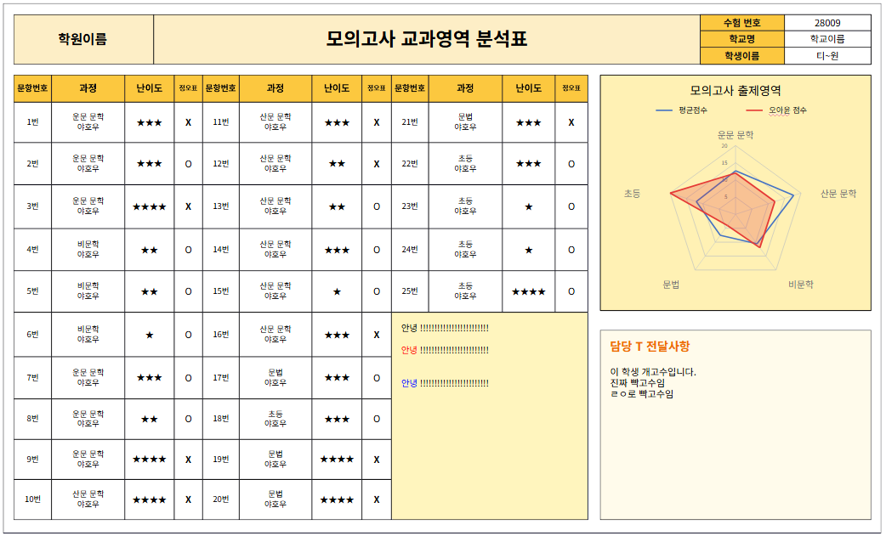
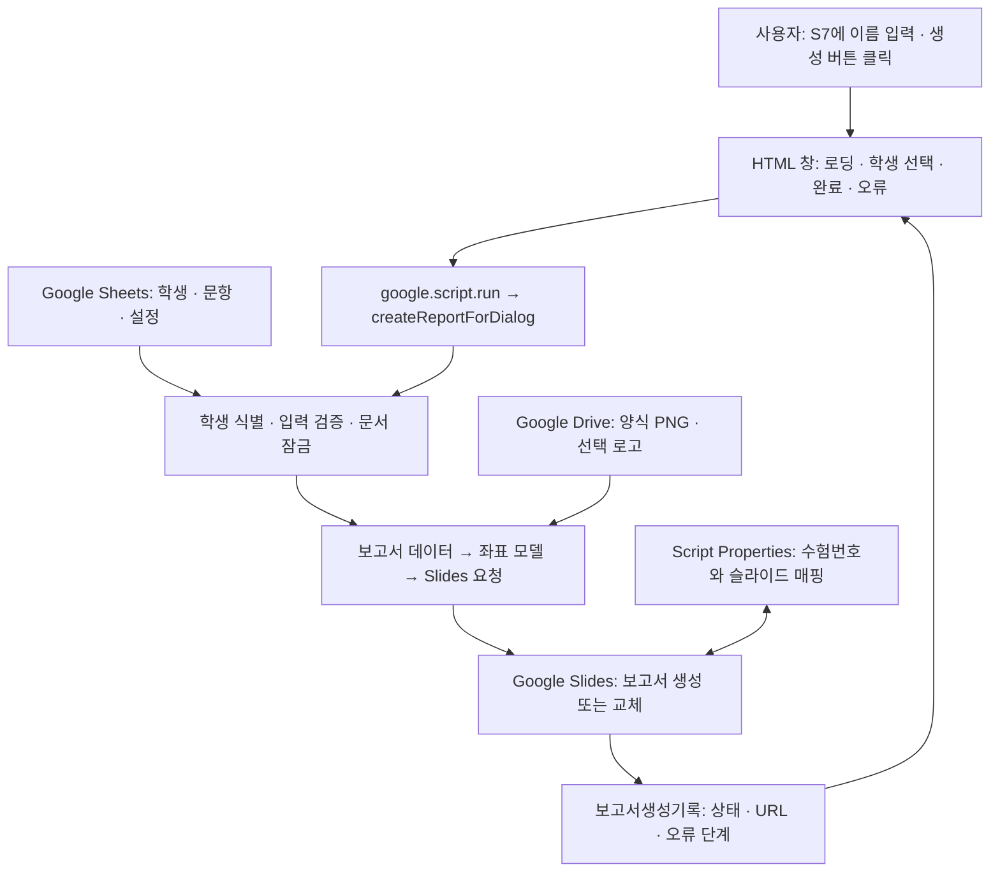

# 국어 모의고사 분석 보고서 자동화

Google Sheets에 학생 이름을 입력하고 버튼을 누르면, 해당 학생의 문항별 결과와 영역별 점수를 Google Slides 보고서로 생성하는 프로젝트임.

기존 보고서 양식을 유지하면서 학생 정보, 글자색, 정오표, 오각형 그래프와 교사 전달사항을 자동으로 배치함. 학원의 입력 방식과 보고서 형태를 기준으로 기능을 반복 개선함.



> 동일한 좌표 모델을 사용한 합성 데이터 예시이며, 실제 운영 화면 캡처는 아님.

## 프로젝트 요약

| 항목 | 내용 |
| --- | --- |
| 해결하려는 문제 | 스프레드시트의 학생별 데이터를 보고서 양식에 반복해서 옮기는 작업 |
| 사용자 동작 | 학생 이름 입력 → 보고서 생성 버튼 → 결과 슬라이드 확인 |
| 입력 | Google Sheets의 수험생데이터·시험지데이터 |
| 처리 | Google Apps Script V8, HTML Service, Google Slides API |
| 출력 | 기존 PNG 양식 위에 텍스트·선·도형을 배치한 Google Slides |
| 재생성 기준 | 같은 프레젠테이션·같은 스크립트 프로젝트에서 수험번호로 기존 보고서 교체 |
| 운영 이슈 | 다른 사용자의 Drive 이미지 접근 권한 문제를 확인하고 해결 |

## 주요 기능

| 기능 | 구현 내용 |
| --- | --- |
| 학생 검색 | `수험생데이터!S7`의 이름과 C열을 비교하고, 동명이인은 수험번호·학교로 선택 |
| 학생 정보 | 같은 행의 A열 수험번호, C열 학생명, D열 학교명 사용 |
| 문항별 결과 | 25문항의 영역·갈래 태그, 검정 난이도 별표, O/X 자동 배치 |
| 부분 글자색 | 한 셀에 섞인 빨강·파랑·검정 구간을 보고서에 반영 |
| 공통·개별 메시지 | `시험지데이터!H27` 공통 설명과 학생별 P열 전달사항 배치 |
| 오각형 그래프 | 다섯 영역의 평균선과 학생선, 불투명도 0.25의 학생 점수 면 표현 |
| 상단 문구 | 학원명·학교명 표시, 한국 시간의 생성 월에 따라 보고서 제목 갱신 |
| 생성 창 | 회전 로딩 아이콘, 완료 후 보고서 열기, 오류 안내와 다시 시도 |
| 재생성·동시 실행 | 임시 슬라이드를 준비한 뒤 기존 페이지 교체, 문서 잠금으로 생성 작업 조정 |
| 기록·진단 | 생성 결과 기록, 오류 상태 빨간 글씨, 파일별 접근 확인과 실패 단계 표시 |

입력된 오답 번호 목록을 기준으로 문항별 O/X를 결정함. 영역별 점수와 교사가 작성한 분석 문장을 읽어 보고서의 각 영역에 배치함.

## 전체 구조



Google Sheets를 데이터 입력 화면으로 사용하고, Apps Script가 데이터 조회·검증·보고서 생성을 담당함. HTML 창과 서버 함수는 비동기로 연결해 생성 상태와 결과를 표시함.

## 핵심 구현

### 1. 양식과 데이터 배치 분리

원본 PNG를 배경으로 사용하고, 학생별 값은 좌표 모델을 통해 별도의 텍스트·도형으로 생성함. 양식과 값의 배치를 분리해 기존 문서 형태를 유지함.

### 2. 부분 글자색 보존

셀의 전체 글자색과 RichTextValue의 부분 색상 구간을 함께 읽음. 영역·갈래 태그를 합치거나 줄바꿈을 조정한 뒤에도 색상 위치를 다시 연결함. 난이도 별표에는 검정색을 별도로 적용함.

### 3. 편집 가능한 오각형 그래프

학생 점수와 평균 점수를 같은 좌표축에 배치하고, 선과 반투명 삼각형 도형으로 그래프를 구성함. 평균선 → 학생 점수 면 → 학생선 순서로 생성하며, 학생 면의 불투명도는 0.25로 설정함. 생성된 텍스트와 도형은 Slides에서 편집 가능한 요소로 구성함.

### 4. 수험번호 기반 보고서 갱신

수험번호를 기준으로 기존 보고서를 찾고, 새 페이지를 준비한 뒤 기존 페이지를 교체함. API 요청 실패 시 기존 매핑을 유지하고 임시 페이지 정리를 시도함. 문서 잠금으로 동시에 들어오는 생성 요청을 조정함.

### 5. 권한 오류 진단과 개선

다른 사용자가 실행할 때 발생한 파일 ID 오류의 원인을 Drive 이미지 접근 권한에서 확인함. 파일별 접근 검사와 실패 단계 표시를 추가하고, 공유 이미지 링크의 접근 키 처리도 보완함.

## 구현 결과

학생별 보고서 작성 과정을 이름 입력과 버튼 실행으로 연결함. 문항별 결과, 부분 글자색, 영역별 비교 그래프와 전달사항을 정해진 양식에 일관되게 배치하도록 구현함.

생성 상태와 오류 내용을 화면·기록 탭에 남겨 사용자가 결과를 확인하고 실패 원인을 추적할 수 있도록 구성함.

## 저장소 구성

```text
.
├── README.md
├── apps-script/
│   ├── Code.gs
│   ├── appsscript.json
│   ├── dialog-ui.template.html
│   ├── report-template.png
│   └── report-button.png
├── future-development/
│   ├── README.md
│   └── node/
│       ├── package.json
│       ├── scripts/
│       └── tests/
└── docs/
    ├── architecture.md
    ├── data-mapping.md
    ├── troubleshooting.md
    ├── portfolio-case-study.md
    └── assets/report-preview.png
```

## 현재 구현 범위

현재는 지정된 25문항 양식과 시트 구조를 대상으로 구현함. 같은 수험번호의 재생성은 기존 페이지를 교체하는 방식임.

## 추후 개선 사항

### 독립 프로그램으로 발전될 가능성

현재의 학생 데이터 처리와 보고서 배치 구조를 바탕으로, 별도 입력 화면과 작업 관리를 갖춘 독립 프로그램으로 확장하는 방안을 검토함. Node.js는 이 과정에서 보고서 처리 모듈의 실행 환경 후보로 정리함.

기존 Node 기반 검증 코드와 보조 스크립트는 향후 확장 검토용 참고 자료로 분리함. 독립 프로그램의 구현은 추후 개선 단계로 두고, 구체적인 확장 방향은 [프로그램 확장 검토](future-development/README.md)에 정리함.

### 보고서 업무 확장

시험 ID를 포함한 이력 관리, 설정 기반 열 매핑, 여러 학생의 생성 요청을 순서대로 처리하는 작업 큐를 추가 개선 대상으로 정리함.

[설계 상세](docs/architecture.md) · [데이터 연결표](docs/data-mapping.md) · [문제 해결 기록](docs/troubleshooting.md) · [포트폴리오 설명문](docs/portfolio-case-study.md) · [추후 확장 방향](future-development/README.md)
