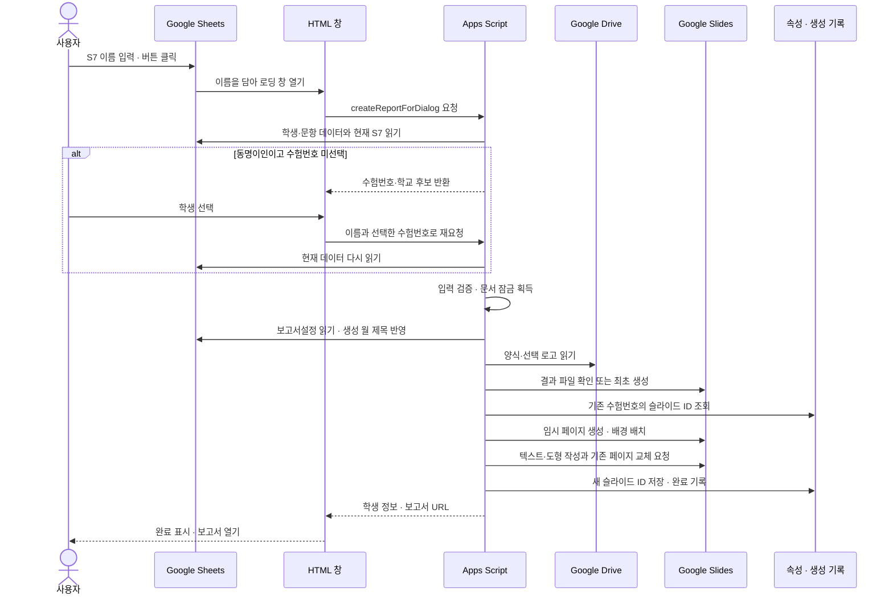

# 설계와 실행 구조

[프로젝트 소개로 이동](../README.md)

## 1. 구성 요소

Google Sheets에 연결된 Apps Script를 중심으로 입력 데이터, 보고서 양식, 결과 슬라이드를 연결함. 브라우저의 HTML 창은 생성 상태 표시와 동명이인 선택을 담당함.

| 계층 | 역할 | 주요 코드 |
| --- | --- | --- |
| 사용자 창 | 로딩·동명이인 선택·완료·오류, 요청 중복 방지 | dialog-ui.template.html |
| 실행 조정 | 요청 검증, 학생 확정, 잠금, 단계 기록 | generateReportByName, createReportForDialog |
| 입력 읽기 | 값·표시값·부분 글자색을 같은 범위에서 조회 | readSourceRows_, loadSourceData_, readConfig_ |
| 데이터 검증 | 수험번호, 25문항, 난이도, 오답, 점수 검증 | buildReportFromSource_, parseWrongAnswers_ |
| 보고서 모델 | 화면 요소를 텍스트·선·도형 목록으로 구성 | buildReportModel_, inputHeader_, inputQuestions_, inputRadarChart_ |
| 배치·색상 | 줄바꿈·글꼴 크기 추정, 색상 구간 재연결, 페이지 크기 변환 | fitText_, fittedColorRuns_, pageTransform_ |
| 외부 파일 접근 | Drive 이미지 읽기, 공유 링크 접근 키, 파일별 진단 | readImageBlob_, extractDriveReference_, checkReportFileAccess |
| Slides 출력 | 새 페이지 준비, API 요청 구성, 기존 페이지 교체 | modelToRequests_, renderReport_ |
| 상태 보관 | 수험번호와 페이지 매핑, 생성 이력 | PropertiesService, appendReportLog_ |

## 2. 생성 순서



창에 전달된 이름과 서버가 다시 읽은 S7 이름을 비교함. 이름이 달라졌다면 작업을 중단하고, 동명이인을 선택한 뒤에도 현재 데이터를 다시 읽어 학생을 확인함.

## 3. 학생 식별과 데이터 모델

이름을 조회 조건으로 사용하고, A열 수험번호를 보고서 갱신의 식별자로 사용함. 수험번호는 표시값을 읽어 앞자리 0을 보존함. 같은 이름이 여러 명이면 수험번호와 학교로 구분하며, 수험번호가 비어 있거나 중복이면 생성을 중단함.

입력 검증 후 학생 정보, 25개 문항, O/X 목록, 점수와 평균, 메시지, 색상 정보를 보고서용 객체로 구성함. 이후 시트 데이터와 분리된 좌표 모델을 생성해 Slides 요청으로 변환함.

## 4. 양식과 좌표 모델

3216 × 1960 PNG를 기준 양식으로 사용함. 각 요소에 기준 좌표, 크기, 글꼴 크기, 색상, 정렬 값을 부여함.

실제 슬라이드 크기에는 가로·세로 비율 중 작은 값을 적용해 원본 비율을 유지하고 중앙에 배치함.

```text
scale = min(pageWidth / 3216, pageHeight / 1960)
```

문항은 10 + 10 + 5개 블록으로 구성함. 25번 아래 회색 영역에는 시험지 공통 설명을 넣고, 오른쪽에는 그래프와 학생별 전달사항을 배치함.

배경 이미지를 넣은 뒤 텍스트·선·삼각형을 별도의 Slides 요소로 생성해 편집 가능한 보고서로 구성함.

## 5. 부분 글자색과 줄바꿈

값, 표시 문자열, RichTextValue, 전체 글자색을 함께 읽음. 부분 색상은 시작·끝 위치와 RGB 값으로 보관하고, 테마 색상도 원본 시트의 실제 색으로 변환함.

문자열 결합이나 줄바꿈 조정 후 공백을 제외한 문자 순서를 대응시켜 색상 구간을 다시 구성함. 이모지처럼 JavaScript 문자열에서 두 칸을 사용하는 문자도 같은 위치 규칙으로 처리함. 대응이 맞지 않으면 오류로 중단함.

글자별 대략적인 폭과 줄 높이로 텍스트 크기를 계산함. 최소 크기에서도 영역을 넘으면 해당 항목의 입력을 줄이도록 안내함. 원본에 직접 지정한 글자색을 반영하며, 난이도 별표는 검정으로 고정함.

## 6. 오각형 그래프

축 순서를 운문 문학 → 산문 문학 → 비문학 → 문법 → 초등으로 구성함. 점수 v와 공통 최댓값 max를 기준으로 각 축 i의 좌표를 계산함.

```text
angle = 2π × i / 5
x = centerX + sin(angle) × radius × v / max
y = centerY - cos(angle) × radius × v / max
```

다섯 평균점을 파란 선으로 연결함. 학생의 다각형은 중심점과 인접한 두 꼭짓점으로 구성한 최대 다섯 삼각형으로 채움. 면의 불투명도는 0.25로 설정하고, 마지막에 빨간 학생선을 생성함. 면적이 0인 삼각형은 제외함.

그래프 최댓값을 고정하지 않은 경우 학생 점수와 평균 점수를 함께 보고 공통 눈금을 결정함. 두 계열은 같은 점수 단위를 기준으로 비교함.

## 7. 재생성과 실패 처리

Script Properties에 프레젠테이션 ID와 수험번호를 조합한 키로 슬라이드 ID를 저장함.

```text
REPORT_SLIDE_<프레젠테이션ID>_<수험번호> → 슬라이드ID
```

매핑된 페이지가 있으면 새 페이지를 준비하고, 최종 batchUpdate에 새 요소 작성·페이지 위치 조정·기존 페이지 삭제를 함께 포함함. 새 학생은 페이지를 추가함.

임시 페이지 생성, 배경 삽입, 속성 저장, 기록 저장은 해당 배치 밖에서 처리함. 전체 과정이 하나의 원자적 작업으로 묶인 구조는 아님.

API 실패 시 임시 페이지 정리를 시도함. Slides 반영 후 속성 저장이 실패한 경우 이미 완성된 페이지는 유지함. 속성 매핑 복구와 시험별 이력 관리는 이후 개선 대상으로 정리함.

## 8. 동시 실행과 창 상태

클라이언트에서 처리 중 중복 호출을 막음. 서버에서는 DocumentLock을 1초 동안 획득하려고 시도하고, 다른 작업이 점유 중이면 재시도를 안내함.

HTML 창을 로딩·학생 선택·완료·오류 상태로 구성함. 서버 결과와 통신 실패를 구분하고, 완료 응답의 링크 형식을 확인한 뒤 보고서 열기 버튼에 연결함.

## 9. 생성 기록

생성시각·수험번호·학생명·원본 행·상태·슬라이드 URL·오류 내용을 기록함. 오류에는 실패 단계와 원래 메시지를 함께 남기고, 오류 상태를 빨간 글씨로 구분함.

현재 갱신 키는 프레젠테이션 ID와 수험번호로 구성함. 시험 ID와 월별 구분은 이후 이력 관리 개선에 반영할 항목으로 정리함.
